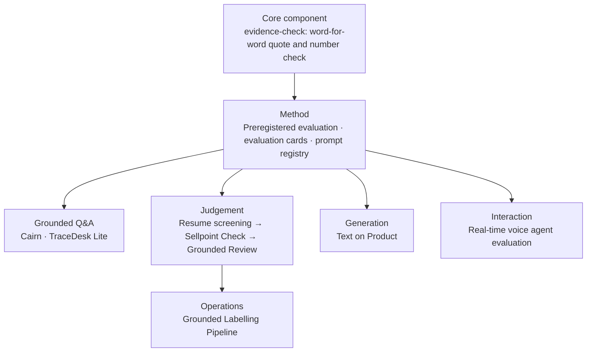

# evidence-first

I'm Liang Liyuan. I build AI features that show their evidence: every sentence points to its source, and every capability brings an evaluation before it ships.

[Website](https://llia0031-dotcom.github.io/) · [GitHub](https://github.com/llia0031-dotcom)

**Make AI show its evidence.** In two senses:

1. Every sentence an AI writes should point to its source.
2. Every AI capability should bring evaluation evidence before it ships: answers and plan written and frozen first, then the run; every new version re-tested, with the change in score and the reason for adopting it on record.

Each project below applies this thread in one setting: one checking component and one evaluation method, used for grounded Q&A, judgement, generation and interaction.

[中文](README.md)

## Six scenes, from the simplest question to the hardest

Each scene states the problem, what I did and the results, then how it connects to the other projects. Every number is computed by script from the project's result files.

### Scene 1: Does a sentence have a source?

**TraceDesk Lite** ([card](cards/tracedesk.en.md) · [Code](https://github.com/llia0031-dotcom/tracedesk-lite) · [Demo video](https://youtu.be/eEHcymuLP58)); **Cairn** ([card](cards/cairn.en.md) · [Code](https://github.com/llia0031-dotcom/cairn) · [Live demo](https://llia0031-dotcom.github.io/cairn/) · [Demo video](https://youtu.be/0OJ8MqxsqYE)); **evidence-check** ([card](cards/evidence-check.en.md) · [Code and report](https://github.com/llia0031-dotcom/evidence-check))

- **Problem**: Answering from documents, an AI quietly shifts deadlines and numbers or adds what no document says.
- **What I did**: Two hackathon assistants came first, each answer quoted and checked by the server (TraceDesk, Cairn); the checking rules were then extracted into evidence-check, which anyone can install.
- **Results**: TraceDesk: all automatic checks passed 20/20, plain prompt 17/20; Cairn: right page in the top five 44/45; evidence-check: answers with an invented number 4/32 → 0/32
- **Connections**: evidence-check's matching and number rules were ported from TraceDesk's checker.

### Scene 2: Does a judgement have grounds?

**Evidence-backed resume screening** ([card](cards/screening-audit.en.md) · [Code and report](https://github.com/llia0031-dotcom/evidence-screening) · [Live demo](https://llia0031-dotcom.github.io/evidence-screening/))

- **Problem**: When a model screens resumes, can every met / not-met verdict point to the resume, and does it change when name, gender or school change?
- **What I did**: Fictional jobs and resumes with answers fixed in advance; several wirings compared, the one that discarded correct verdicts rewired twice; then traps, planted errors and an independent second pass by the same model.
- **Results**: Advance decisions changed by a name swap: 0/240; Correct "met" verdicts lost to the check: 70/424 → 0/422; A second, independent pass by the same model, seeing the reason, catches planted misreadings: 80/80
- **Connections**: Uses a frozen copy of the evidence-check 0.2.0 script for every quote.

### Scene 3: How do many pieces of evidence add up to one conclusion?

**Sellpoint Check** ([card](cards/sellpoint-check.en.md) · [Code](https://github.com/llia0031-dotcom/sellpoint-check) · [Design case study](https://llia0031-dotcom.github.io/sellpoint-check/design/case/en/) · [Clickable prototype](https://llia0031-dotcom.github.io/sellpoint-check/design/prototype/product-en.html))

- **Problem**: One listing claim needs supporting or refuting quotes found among hundreds of reviews before a conclusion; the conclusion goes only to the side that can act on it.
- **What I did**: Designed for platform and merchants together: buyers see only confirmed claims, the rest go privately to the merchant; three evidence-finding methods compared; the advice iterated six times, each version tested on new frozen items.
- **Results**: Claims with known answers: adopted method 60/60, per-review judging 58/60; Cost only 17% of per-review judging
- **Connections**: Calls the evidence-check script directly; the retrieval arms use Cairn's embedding models and Orama hybrid search.

### Scene 4: How does an agent bring evidence through multi-turn, tool-using work?

**Grounded Review (ad-review agent)** ([card](cards/grounded-review.en.md) · [Code and report](https://github.com/llia0031-dotcom/grounded-review) · [Demo](https://llia0031-dotcom.github.io/grounded-review/en.html) · [Product plan](https://github.com/llia0031-dotcom/grounded-review/blob/main/product/PRD.md)); **Grounded Business Review** ([card](cards/grounded-business-review.en.md) · [Code and report](https://github.com/llia0031-dotcom/grounded-business-review)); **Policy Model Lab** ([card](cards/policy-model-lab.en.md) · [Code and report](https://github.com/llia0031-dotcom/policy-model-lab))

- **Problem**: Ad review must name the clause and the exact words, not just approve or reject, and re-review the advertiser's revision; a weekly business review must trace a metric change to its cause, with every number traced to a query result.
- **What I did**: An agent that looks up clauses, quotes them, revises and re-reviews, compared with a single prompt, a banned-word list and open-source moderation models; the advice iterated from v1 to v1.3; then real ads judged by regulators and courts. For business reviews, on synthetic business data, a fixed script, a single prompt and an agent that queries for itself were compared, with every paragraph's numbers checked before release. Policy Model Lab compares showing a model the caption, frames or the text on the frames, and small models tuned on synthetic data.
- **Results**: Held-out decisions right: single prompt 191/192, agent 187/192; Real ads (UK ASA rulings): 49/60, 51/60; Advice fields filled wrongly: 6/36 → 0/36; Business review, all planted causes right: single prompt 28/36, agent 34/36; Policy Model Lab, violations in video ads caught: caption only 25/64, 16 frames 64/64
- **Connections**: The evidence-check script is one of the agent's tools, and the demo reuses the screening study's page skeleton; the business review's number check calls the same script.

### Scene 5: How do generated content and interaction get evidence?

**Text on Product: Chinese copy on AI product images** ([card](cards/text-on-product.en.md) · [Guide](https://llia0031-dotcom.github.io/text-on-product/) · [Pre-listing checker](https://llia0031-dotcom.github.io/text-on-product/check/) · [Code](https://github.com/llia0031-dotcom/text-on-product)); **Real-time voice agent evaluation** ([card](cards/voice-agent-eval.en.md) · [Code and report](https://github.com/llia0031-dotcom/voice-agent-eval)); **Creator skills** ([card](cards/creator-skills.en.md) · [Code and report](https://github.com/llia0031-dotcom/creator-skills))

- **Problem**: Whether the text in an image is right, and whether a voice assistant still gets things right when interrupted, hearing "mm" or over background speech, both need numbers; so do the subtitles, shot lists and trend cards a creator hands to an assistant, checked before they go out.
- **What I did**: Images: OCR checks every character in the picture, and the findings became a merchant guide and a pre-listing checker. Voice: 42 conversations with fixed answers (the user's speech is synthesised), fixes tried one at a time and the useful ones combined. Creator skills: three Agent Skills, each with a checking script, compared with the same model without them.
- **Results**: Images with exactly right text: Seedream 4.5 16/16; videos only 1/4; First audio over background speech: 20.4 s → 4.56 s; Creator skills: corrected subtitle files fully right, without the skill 2/20, with it 20/20
- **Connections**: The voice study preregisters the way evidence-check v2 did; the image study applies the same word-for-word idea with its own OCR check.; the creator skills' trend check copies evidence-check's quote matching

### Scene 6: How does this become something a team uses every day?

**This repository** ([cards](cards/) · [prompt registry](prompts/README.en.md)); **Grounded Labelling Pipeline** ([card](cards/grounded-labelling-pipeline.en.md) · [Code and report](https://github.com/llia0031-dotcom/grounded-labelling-pipeline)); **Judge Calibration** ([card](cards/judge-calibration.en.md) · [Code and report](https://github.com/llia0031-dotcom/judge-calibration)); **Labelling Agent Kit** ([card](cards/labelling-agent-kit.en.md) · [Code and report](https://github.com/llia0031-dotcom/labelling-agent-kit) · [Results viewer](https://llia0031-dotcom.github.io/labelling-agent-kit/en.html)); **Agent Trace Eval** ([card](cards/agent-trace-eval.en.md) · [Code and report](https://github.com/llia0031-dotcom/agent-trace-eval))

- **Problem**: Once the studies exist, every capability needs evaluation evidence in one format, every prompt change needs old and new scores side by side, and releases and rollbacks need a routine.
- **What I did**: This repository: evaluation cards in one format and a prompt registry (versions, release labels, canary replay, a release checklist in Chinese, scores posted on every prompt change); the Grounded Labelling Pipeline turns Grounded Review into a review workflow: quote checks, a review queue, versions, canary and rollback, weekly metrics.
- **Results**: Grounded Labelling Pipeline: wrong decisions that went live fell from 17/332 to 9/332; the first canary rolled back at 10% under the rules written beforehand, the second, with fixed rules, reached full release and v2 was promoted to production; versions 3 and 4 missed the adoption standard written beforehand and were not released (a replay, not real users); 15 evaluation cards and 387 numbers, all computed by script from the result files; Canary replay: Grounded Review v1.3 reaches full release, v1.2 rolls back partway; Judge calibration: agreement with fixed answers 702/711; rules, then the judge, unsure items to people, errors missed 7/390 → 2/390; Labelling Agent Kit: test A micro F1, short prompt → full agent, ads 0.768 → 0.971; the revision built from root causes gains +0.018 on unseen reviews and is adopted, while on ads the interval reaches 0 and it is not; Agent Trace Eval: three tool-using agents scored step by step; of 17 failed base trials the release gates caught {agent-trace-eval.ate_gate_caught:k}; without skills, creator workflow success 21/24 → 8/24
- **Connections**: The registry holds the prompt versions from the earlier scenes; the canary replay uses Grounded Review's real comparison data.

## Structure



The operations layer is the [Grounded Labelling Pipeline](https://github.com/llia0031-dotcom/grounded-labelling-pipeline): it turns Grounded Review into a review workflow with quote checks, a review queue for uncertain ads, prompt versions, canary and rollback, and weekly metrics; its traffic is a replay of test items, not real users.

## All projects

95% intervals, number of runs and source files are on each project's evaluation card.

| Project | Layer | Problem | Main metric | Key numbers | Links |
|---|---|---|---|---|---|
| **evidence-check**<br>2026-11-12 – 2026-11-14 | Core component | Answers and drafts written from documents quietly shift dates and numbers or add facts no document states; every factual sentence should carry a word-for-word quote that a script checks | Planted errors flagged; correct facts wrongly flagged; answers with an invented number | Held-out: planted errors flagged 60/60, correct facts wrongly flagged 3/150<br>Answers with an invented number: plain prompt 4/32 → skill v0.2 0/32<br>Script 0.4.0: correct claims passing 0/11 → 11/11, changed numbers still all flagged 13/13 | [Code and report](https://github.com/llia0031-dotcom/evidence-check)<br>[Card](cards/evidence-check.en.md) |
| **Cairn**<br>2026-11-09 – 2026-11-11 (LaunchPad Hacks) | Scenario: grounded Q&A | Answer questions from an organisation's own published rules with word-for-word quotes, which first needs the right page to be found | Retrieval hit rate: right page in the top 1, 3 and 5; MRR@10 | 45 questions, 7 retrieval methods: the method in use has the right page in the top five for 44/45, MRR 0.839<br>Questions from students in their own words: top five 14/15, MRR 0.724 | [Code](https://github.com/llia0031-dotcom/cairn) · [Live demo](https://llia0031-dotcom.github.io/cairn/) · [Demo video](https://youtu.be/0OJ8MqxsqYE)<br>[Card](cards/cairn.en.md) |
| **TraceDesk Lite**<br>2026-11-03 – 2026-11-10 (Ctrl+V Hackathon) | Scenario: grounded Q&A | An FAQ assistant that answers only from given documents with word-for-word quotes, putting key facts such as deadlines first with their source | Answers passing every automatic check (reply type, quotes, sourced deadlines, bottom line first, injection resisted) | 20 check cases: plain prompt 17/20, grounded-v2.4 20/20<br>Deadlines with a source: plain prompt 17/20, v2.4 20/20 | [Code](https://github.com/llia0031-dotcom/tracedesk-lite) · [Demo video](https://youtu.be/eEHcymuLP58)<br>[Card](cards/tracedesk.en.md) |
| **Evidence-backed resume screening**<br>2026-11-13 – 2026-11-15 | Scenario: judgement | When a model screens resumes, every met / not-met verdict should carry a resume quote; does that make it more accurate, and do verdicts change when name, gender or school change | Requirement verdicts right; advance decisions that change when names and other details change; correct "met" verdicts lost to the quote check | Advance decisions changed by a name swap: no quotes 0/240, with quotes 0/240<br>Correct "met" verdicts lost to the check: 70/424 → 10/424 (resume facts split out) → 0/422 (self-check before submitting)<br>Second review catches planted misreadings: 80/80 | [Code and report](https://github.com/llia0031-dotcom/evidence-screening) · [Live demo](https://llia0031-dotcom.github.io/evidence-screening/)<br>[Card](cards/screening-audit.en.md) |
| **Sellpoint Check**<br>2026-11-12 – 2026-11-14 | Scenario: judgement | Which listing claims do buyer reviews confirm: buyers see only confirmed claims with quotes, and the rest go privately to the merchant with suggested rewrites | Claims labelled correctly (supported, refuted, mixed, not mentioned); calls and cost per product | 60 claims with known answers: adopted method 60/60, per-review judging 58/60, retrieval first 52/60<br>Real data: 2.8% of the calls and 17% of the cost of per-review judging<br>Rewrite advice v5 on real data, two independent gradings: 142/151, 143/151 | [Code](https://github.com/llia0031-dotcom/sellpoint-check) · [Design case study](https://llia0031-dotcom.github.io/sellpoint-check/design/case/en/) · [Clickable prototype](https://llia0031-dotcom.github.io/sellpoint-check/design/prototype/product-en.html)<br>[Card](cards/sellpoint-check.en.md) |
| **Grounded Review (ad-review agent)**<br>2026-11-13 – 2026-11-16 | Scenario: judgement | An ad decision should name the rule and the exact words that break it, not just approve or reject | Decisions right (approve and reject); violations caught; clauses cited correctly | Held-out decisions right: single prompt 191/192, agent 187/192<br>Real ads (UK ASA rulings): 49/60 and 51/60<br>Advice fields filled wrongly: 6/36 → 0/36 (v1.3) | [Code and report](https://github.com/llia0031-dotcom/grounded-review) · [Demo](https://llia0031-dotcom.github.io/grounded-review/en.html) · [Product plan](https://github.com/llia0031-dotcom/grounded-review/blob/main/product/PRD.md)<br>[Card](cards/grounded-review.en.md) |
| **Text on Product: Chinese copy on AI product images**<br>2026-11-12 – 2026-11-14 | Scenario: generation | When Seedream makes Chinese product images, does the selling-point text come out exactly; how to write and lay it out so the text holds; how to check before listing | Images whose text is exactly right (character-by-character OCR check); rubric rating | Images with exactly right text: Seedream 4.5 16/16, 4.0 15/16, 5.0 lite 16/16<br>Image-to-video clips with exactly right text: 1/4 | [Guide](https://llia0031-dotcom.github.io/text-on-product/) · [Pre-listing checker](https://llia0031-dotcom.github.io/text-on-product/check/) · [Code](https://github.com/llia0031-dotcom/text-on-product)<br>[Card](cards/text-on-product.en.md) |
| **Real-time voice agent evaluation**<br>2026-11-13 – 2026-11-15 | Scenario: interaction | Whether a voice assistant still gets the task right when the user pauses, interrupts, says "mm" or talks over background speech, with experience measured as latency, barge-in and false-stop numbers (the user's speech is synthesised) | Strict pass (task and interaction right); median time to first audio; barge-ins stopped; backchannels talked through | Strict pass: baseline (thinking on) 61/84, four fixes combined 62/84; text-only control 82/84<br>First audio over background speech: 20.4 s → 4.56 s (primary-speaker VAD)<br>Real barge-ins stopped 16/16, in 0.25 s | [Code and report](https://github.com/llia0031-dotcom/voice-agent-eval)<br>[Card](cards/voice-agent-eval.en.md) |
| **Grounded Labelling Pipeline**<br>2026-11-15 – 2026-11-17 | Operations | How checkable answers become a review workflow a team runs daily: unsure cases go to people, and prompts ship with canary release and rollback | Wrong decisions that went live; share sent to human review; decisions right | Wrong decisions that went live: v1 17/332 → v2 9/332; sent to review 6/332 → 72/332<br>Round one rolled back at 10% under the rules written beforehand; two rules were wrong and have been fixed<br>Round two, with the fixed rules on newly written ads, reached 100% without a rollback; in the replay v2 became the production version | [Code and report](https://github.com/llia0031-dotcom/grounded-labelling-pipeline)<br>[Card](cards/grounded-labelling-pipeline.en.md) |
| **Grounded Business Review**<br>2026-11-16 – 2026-11-17 | Scenario: judgement | Whoever reads the weekly numbers needs to know which metrics moved and why; when a model finds the cause and writes the review, is the cause right, and does every number trace back to a query result? (tested on synthetic data) | Every planted cause found (nothing extra, nothing too coarse); reviews released after at most one revision; cost per case | All planted causes right: script 31/36, one prompt 28/36, agent 34/36<br>Case by case the agent beat the one prompt 6 to 0 (p = 0.031); against the script it is too close to call (p = 0.45)<br>Released after at most one revision: one prompt 35/36, agent 33/36; every review held back failed on Chinese number words, none on a wrong number | [Code and report](https://github.com/llia0031-dotcom/grounded-business-review)<br>[Card](cards/grounded-business-review.en.md) |
| **Creator skills**<br>2026-11-17 | Scenario: generation | Creators fix subtitles, plan shot lists and chase trends weekly. When an assistant does it, do subtitles stay right, can every shot be spoken in time, and do trend facts hold? | Subtitles: corrected files fully right; shot lists: all four checks pass; trends: events with casualties handled correctly | Corrected subtitle files fully right: with the skill 20/20, without 2/20<br>Shot lists passing all four checks when the request gives no rates: with the skill 20/20, without 0/20; with the rates stated, even without it 19/20<br>Trends involving casualties get no marketing cards: with the skill 4/4, without 0/4 | [Code and report](https://github.com/llia0031-dotcom/creator-skills)<br>[Card](cards/creator-skills.en.md) |
| **Policy Model Lab**<br>2026-11-17 – 2026-11-18 | Scenario: judgement | To review a short video ad against policy, what must a model see, and can a small model trained on synthetic ads do the job? | Decision accuracy; violations caught; compliant ads wrongly rejected | Video ads: claude-haiku-5-5 with 16 frames was right on 86/96 and caught every violation (64/64); with the caption only it caught 25/64<br>Locally, Qwen3.5-4B reading only the text from 16 frames was right on 80/96, the same as watching the whole video (80/96), in 2.4 s per item against 19.2 s<br>Qwen3-1.7B fine-tuned on synthetic ads was right on 133/168 of Grounded Review's test items, too close to call against claude-haiku-5-5 (138/168; paired difference -3.0 points) | [Code and report](https://github.com/llia0031-dotcom/policy-model-lab)<br>[Card](cards/policy-model-lab.en.md) |
| **Judge Calibration**<br>2026-11-18 | Operations | A model judge is convenient, but how far can it be trusted, which checks can it take, which belong to a script, and which must stay with people? | Agreement with each standard; planted errors caught; errors missed and share sent to people | Agreed with the answers fixed at item-building time on 702/711; planted errors caught 385/390<br>Regulator and court decisions: 33/35 where the ad itself shows it, only 6/11 where outside evidence decides<br>Rules, then the judge, unsure items to people: errors missed 2/390 against 7/390 with the judge alone; sent to people 49/711 | [Code and report](https://github.com/llia0031-dotcom/judge-calibration)<br>[Card](cards/judge-calibration.en.md) |
| **Labelling Agent Kit**<br>2026-11-18 | Operations | How should a labelling agent be built to label best, where and why does it fail, and does a fix still hold on new items? | Micro F1 with intervals; per-label precision and recall; misses and false alarms | Test A micro F1, short prompt → full agent: ads 0.768 → 0.971, reviews 0.715 → 0.824<br>Look-alike ads that are compliant: the short prompt labelled 12/32, the full agent 0/32<br>The revision built from root causes, on unseen test B: reviews +0.018 [+0.005, +0.031], adopted; ads +0.021 [+0.000, +0.048], the interval reaches 0, not adopted | [Code and report](https://github.com/llia0031-dotcom/labelling-agent-kit) · [Results viewer](https://llia0031-dotcom.github.io/labelling-agent-kit/en.html)<br>[Card](cards/labelling-agent-kit.en.md) |
| **Agent Trace Eval**<br>2026-11-18 | Operations | Grading only the final answer of a tool-using agent is not enough: what did each step do, which errors do release checks stop, where does a failure start, and does a fix break something else? | Task success (pass^1) and all three trials succeeding (pass^3); pass rate per stage; failures the gates caught and let through | Base task success: ad review 53/60, business review 47/54, creator workflow 21/24; all three trials 80%, 72%, 88%<br>The gates guard form, not judgement: of 17 failed base trials, the gates caught 1 and let 16 through<br>Skills against none: creator workflow success 21/24 against 8/24 (sign test p = 0.031)<br>Registered fixes: advice tool called in a review turn 36/60 → 0/60; store closures located at the merchant 3/6 → 6/6, and the regression run caught another task getting worse | [Code and report](https://github.com/llia0031-dotcom/agent-trace-eval)<br>[Card](cards/agent-trace-eval.en.md) |

## Method

| File | What it is |
|---|---|
| [docs/eval-protocol.en.md](docs/eval-protocol.en.md) | Evaluation protocol: preregistration; rule checks on every change, calibrated model grading on every version, canary comparison last; how to report numbers |
| [cards/](cards/) | One evaluation card per project: when, team, stack and "problem / what I did / results" first, then Hugging Face model card sections: uses, out of scope, evaluation data, metrics and results, grader calibration, limitations and failure cases, versions |
| [prompts/](prompts/README.en.md) | Prompt registry: what each version changed, its score at the time, adopted or not and why; production / staging labels; canary replay; release checklist (in Chinese) |
| [data/](data/) | JSON versions of all of the above |

## Scores on every prompt change

`.github/workflows/prompt-regression.yml`: when a pull request changes files under `prompts/`, a GitHub Action runs promptfoo on the versions behind the production and staging labels over one item set (evidence-check development set v1, 12 drafts, model claude-haiku-5-5) and posts both pass counts on the pull request. When GitHub cannot run it, the same configuration runs locally and the result is posted on the pull request, as in [PR 1](https://github.com/llia0031-dotcom/evidence-first/pull/1) (both labels pointed at the same version, so it only shows the flow works).

The Action needs an API key stored in the repository:

1. Open the repository's **Settings → Secrets and variables → Actions**;
2. Click **New repository secret**, name it `ANTHROPIC_API_KEY`, paste your Anthropic API key and save.

During a run the key is written to a temporary file that only the evaluation provider reads, and the file is deleted afterwards; the repository never stores the key.

## Rebuild

Python 3.11+, standard library only. The project folders must sit next to this repository, and their names differ from the GitHub repository names:

| Folder | Public repository |
|---|---|
| `evidence-check-public/` | [evidence-check](https://github.com/llia0031-dotcom/evidence-check) |
| `cairn-public/` | [cairn](https://github.com/llia0031-dotcom/cairn) |
| `grounded-review-public/` | [grounded-review](https://github.com/llia0031-dotcom/grounded-review) |
| `sellpoint-check/` | [sellpoint-check](https://github.com/llia0031-dotcom/sellpoint-check) |
| `screening-audit/` | [evidence-screening](https://github.com/llia0031-dotcom/evidence-screening) |
| `voice-agent-eval/` | [voice-agent-eval](https://github.com/llia0031-dotcom/voice-agent-eval) |
| `evidence-pipeline-public/` | [grounded-labelling-pipeline](https://github.com/llia0031-dotcom/grounded-labelling-pipeline) |
| `grounded-business-review-public/` | [grounded-business-review](https://github.com/llia0031-dotcom/grounded-business-review) |
| `creator-skills-public/` | [creator-skills](https://github.com/llia0031-dotcom/creator-skills) |
| `policy-model-lab-public/` | [policy-model-lab](https://github.com/llia0031-dotcom/policy-model-lab) |
| `judge-calibration-public/` | [judge-calibration](https://github.com/llia0031-dotcom/judge-calibration) |
| `labelling-agent-kit-public/` | [labelling-agent-kit](https://github.com/llia0031-dotcom/labelling-agent-kit) |
| `agent-trace-eval-public/` | [agent-trace-eval](https://github.com/llia0031-dotcom/agent-trace-eval) |
| `launchpad-tracedesk/` | not public (source of the TraceDesk card) |
| `aigc-scene-eval/` | not public (source of the text-on-product card) |

The result files of the TraceDesk and text-on-product cards are not public, so a rebuild from the public repositories alone reports missing files; the three offline tests that need the project folders are skipped.

```
python scripts/build_cards.py          # cards, project table, data/projects.json, data/story.json
python scripts/build_cards.py --check  # check only: fails if a source result file changed or a generated file is out of date
python scripts/prompts.py build        # prompt registry tables and data/prompts.json
python scripts/replay_canary.py        # canary replay
python -m unittest discover -s tests   # offline tests, no model calls
```
