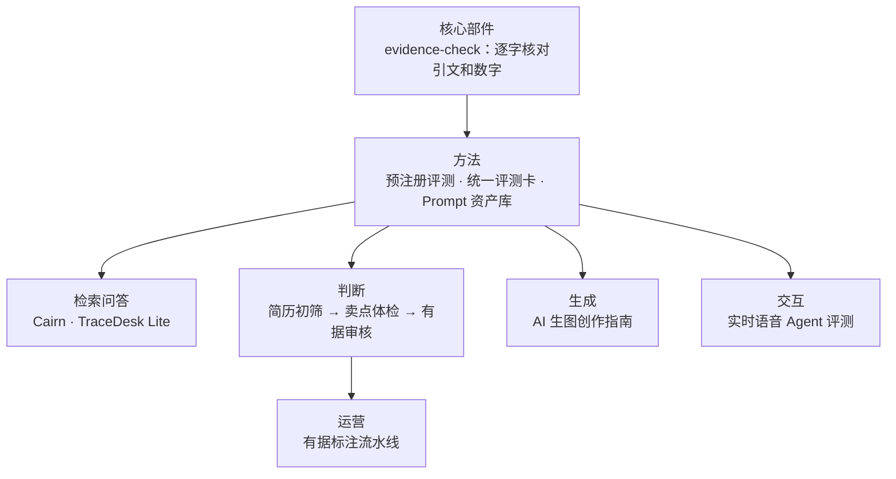

# evidence-first

我是 Liang Liyuan，做会拿出证据的 AI 功能：AI 说的每句话能指到原文，每个能力上线前先拿出评测。

[个人网站](https://llia0031-dotcom.github.io/) · [GitHub](https://github.com/llia0031-dotcom)

**让 AI 拿出证据。** 这句话有两层意思：

1. AI 说的每一句话，都要能指到原文。
2. 每个 AI 能力上线前，都要拿出评测证据：先写好答案和计划，冻结，再跑；每改一版就重测，分数变了、为什么采用都写清楚。

下面的项目都是这条主线在不同场景里的一次落地：一个核对部件、一套评测方法，用在检索问答、判断、生成、交互四类场景。

[English](README.en.md)

## 六幕：按问题从简单到复杂

每一幕写三件事：要解决什么问题、我做了什么、结果是多少；最后一行写它和其他项目怎么连起来。数字都由脚本从项目的结果文件算出。

### 第一幕：一句话有没有出处

**TraceDesk Lite**（[评测卡](cards/tracedesk.md) · [代码](https://github.com/llia0031-dotcom/tracedesk-lite) · [演示视频](https://youtu.be/eEHcymuLP58)）；**Cairn**（[评测卡](cards/cairn.md) · [代码](https://github.com/llia0031-dotcom/cairn) · [在线演示](https://llia0031-dotcom.github.io/cairn/) · [演示视频](https://youtu.be/0OJ8MqxsqYE)）；**有据可查 evidence-check**（[评测卡](cards/evidence-check.md) · [代码和报告](https://github.com/llia0031-dotcom/evidence-check)）

- **问题**：按资料回答问题时，AI 会悄悄改掉截止时间、数字，或者多出资料里没有的话。
- **我做了什么**：两次黑客松里先做了“回答附原文、服务器核对引文”的问答助手（TraceDesk、Cairn）；之后把核对规则抽出来，做成谁都能装的 evidence-check。
- **结果**：TraceDesk：自动检查全部通过 20/20，普通提示 17/20；Cairn：正确页面进前 5 名 44/45；evidence-check：编造数字的回答 4/32 → 0/32
- **和其他项目的连接**：evidence-check 的匹配和数字规则移植自 TraceDesk 的核对代码。

### 第二幕：一条判断有没有依据

**有据可查的简历初筛**（[评测卡](cards/screening-audit.md) · [代码和报告](https://github.com/llia0031-dotcom/evidence-screening) · [演示页](https://llia0031-dotcom.github.io/evidence-screening/)）

- **问题**：模型初筛简历时，“符合 / 不符合”能不能都指到简历原文，换掉名字、性别、学校后结论变不变。
- **我做了什么**：虚构岗位和简历、事先定好答案；比较几种接法，把误伤正确判断的接法改了两版；再用陷阱、植入错误和同一个模型的第二次独立复核检验。
- **结果**：换名字后去留变化：0/240；核对误伤正确的“符合”：70/424 → 0/422；同一个模型再独立复核一次，看得到理由时挑出植入的错读：80/80
- **和其他项目的连接**：用 evidence-check 0.2.0 脚本的冻结副本核对每条引文。

### 第三幕：很多条证据怎么汇总成一个结论

**卖点体检**（[评测卡](cards/sellpoint-check.md) · [代码](https://github.com/llia0031-dotcom/sellpoint-check) · [设计案例](https://llia0031-dotcom.github.io/sellpoint-check/design/case/) · [可点击原型](https://llia0031-dotcom.github.io/sellpoint-check/design/prototype/product.html)）

- **问题**：商品页的一条卖点，要从上百条评价里找出支持或反驳它的原话，再下结论；结论只给能改的一方看。
- **我做了什么**：设计成平台和商家一起用：买家只看被证实的卖点，其余私下交给商家；比较三种找证据的做法；修改建议迭代六版，每版先在新写的冻结题上测。
- **结果**：答案已知的卖点：采用的做法 60/60，逐条判断 58/60；费用只有逐条判断的 17%
- **和其他项目的连接**：直接调用 evidence-check 的核对脚本；“先检索”的做法用的是 Cairn 的检索模型和 Orama 混合检索。

### 第四幕：Agent 在多轮、带工具的任务里怎么拿出证据

**有据审核（广告审核 Agent）**（[评测卡](cards/grounded-review.md) · [代码和报告](https://github.com/llia0031-dotcom/grounded-review) · [演示页](https://llia0031-dotcom.github.io/grounded-review/) · [产品方案](https://github.com/llia0031-dotcom/grounded-review/blob/main/product/PRD.zh-CN.md)）；**有据经营分析**（[评测卡](cards/grounded-business-review.md) · [代码和报告](https://github.com/llia0031-dotcom/grounded-business-review)）；**审核模型实验**（[评测卡](cards/policy-model-lab.md) · [代码和报告](https://github.com/llia0031-dotcom/policy-model-lab)）

- **问题**：广告审核不能只给“通过 / 拒绝”，要说出违反哪一条、是哪几个字，广告主改了以后还要复审；经营周报要从指标异动找到原因，每个数字都要对回查询结果。
- **我做了什么**：做了查条款、引原文、多轮改稿和复审的 Agent，和单个提示词、违禁词表、开源审核模型比较；改稿建议从 v1 迭代到 v1.3；最后换成监管机构和法院定答案的真实广告。经营分析在合成的经营数据上比较固定脚本、一次提示词和自己查数的 Agent，周报放行前逐段核对数字。审核模型实验比较给模型看文案、抽帧还是帧上的字，以及合成数据微调的小模型。
- **结果**：留出集判对：单个提示词 191/192，Agent 187/192；真实广告（英国 ASA 裁决）：49/60、51/60；改稿字段写错：6/36 → 0/36；经营分析，埋好的原因全找对：一次提示词 28/36，Agent 34/36；审核模型实验，视频广告的违规：只看文案抓到 25/64，看 16 帧 64/64
- **和其他项目的连接**：evidence-check 的脚本是 Agent 的一个工具；演示页复用了简历初筛的页面骨架；经营周报的数字核对也直接调用这个脚本。

### 第五幕：生成的内容和交互体验怎么拿证据

**AI 生图创作指南：电商主图上的中文字**（[评测卡](cards/text-on-product.md) · [创作指南](https://llia0031-dotcom.github.io/text-on-product/) · [上线前核对工具](https://llia0031-dotcom.github.io/text-on-product/check/) · [代码](https://github.com/llia0031-dotcom/text-on-product)）；**实时语音 Agent 体验评测**（[评测卡](cards/voice-agent-eval.md) · [代码和报告](https://github.com/llia0031-dotcom/voice-agent-eval)）；**创作者 Skill 合集**（[评测卡](cards/creator-skills.md) · [代码和报告](https://github.com/llia0031-dotcom/creator-skills)）

- **问题**：画面里的字写对没有，语音助手被打断、听到“嗯”、背景有人说话时还办不办得对，都要用数字说话；创作者交给 AI 助手的字幕、分镜和热点选题，交出去之前也要先核对。
- **我做了什么**：AI 生图：OCR 逐字核对画面里的字，结论写成给商家的创作指南和上线前核对工具。语音：42 段事先定好答案的对话（用户语音是合成的），一项一项试改进，把有效的合在一起。创作者 Skill：三个各带核对脚本的 Agent Skill，和不装 Skill 的同一个模型比。
- **结果**：图片文字全对：Seedream 4.5 16/16；视频只有 1/4；背景人声时开口：20.4 秒 → 4.56 秒；创作者 Skill：改好的字幕文件完全正确，不装 2/20，装上 20/20
- **和其他项目的连接**：语音评测照 evidence-check v2 的做法预注册；AI 生图用同样的“逐字核对”思路，有自己的 OCR 核对；创作者 Skill 的热点选题复制了 evidence-check 的引文匹配。

### 第六幕：怎么变成团队能天天用的能力

**本仓库**（[评测卡](cards/) · [Prompt 资产库](prompts/README.md)）；**有据标注流水线**（[评测卡](cards/grounded-labelling-pipeline.md) · [代码和报告](https://github.com/llia0031-dotcom/grounded-labelling-pipeline)）；**模型裁判校准**（[评测卡](cards/judge-calibration.md) · [代码和报告](https://github.com/llia0031-dotcom/judge-calibration)）

- **问题**：一个个评测做完以后，要让每个能力都有同样格式的评测证据、每次改提示词都能看到新旧分数、上线和回滚有章可循。
- **我做了什么**：这个仓库：统一评测卡、Prompt 资产库（版本、上线标签、灰度回放、上线清单、改提示词时自动贴分数）；有据标注流水线把有据审核接成一条审核工作流：核对引文、复核队列、版本、灰度和回滚、每周指标。
- **结果**：有据标注流水线：判错又自动生效的从 17/332 降到 9/332；第一轮灰度按事先写好的规则在 10% 回滚，改好规则后第二轮放到全量，v2 转为正式版本；第 3、4 版都没达到事先写好的采用标准，没上线（回放，不是真实用户）；13 张评测卡、307 个数字全部由脚本从结果文件算出；灰度回放：有据审核 v1.3 放到全量，v1.2 在放量中途触发回滚；模型裁判校准：和定好的答案一致 702/711；先规则、再裁判、拿不准的送人工，漏掉的错误 7/390 → 2/390
- **和其他项目的连接**：资产库收的是前面各幕已有的提示词版本；灰度回放用的是有据审核的真实对比数据。

## 结构



运营层是[有据标注流水线](https://github.com/llia0031-dotcom/grounded-labelling-pipeline)：把有据审核接成一条审核工作流，核对引文、拿不准的进复核队列、提示词版本、灰度和回滚、每周指标；流量是评测题回放，不是真实用户。

## 全部项目

比例的 95% 区间、跑了几次、来源文件都在每个项目的评测卡里。

| 项目 | 层 | 解决什么问题 | 主要指标 | 关键数字 | 链接 |
|---|---|---|---|---|---|
| **有据可查 evidence-check**<br>2026-11-12 – 2026-11-14 | 核心部件 | AI 按资料写的回答和草稿，会悄悄改掉日期、数字，或者多出资料里没有的话；要让每句事实都附逐字原文，再用脚本核对 | 埋进去的错误被标出的比例；正确事实被误标的比例；编造数字的回答数 | 留出评测：埋的错误全部标出 60/60，正确事实误标 3/150<br>编造数字的回答：普通提示 4/32 → Skill v0.2 0/32<br>脚本 0.4.0：正确说法通过 0/11 → 11/11，改错的数字仍全部标出 13/13 | [代码和报告](https://github.com/llia0031-dotcom/evidence-check)<br>[评测卡](cards/evidence-check.md) |
| **Cairn**<br>2026-11-09 – 2026-11-11（LaunchPad Hacks） | 场景：检索问答 | 按一个机构自己公开的规定回答问题，每句话逐字引原文；先要把对的那一页找出来 | 检索命中率：正确页面排进前 1、3、5 名的比例；MRR@10 | 45 道题、7 种检索做法：采用的做法正确页面进前 5 名 44/45，MRR 0.839<br>学生用自己的话提的问题：前 5 名 14/15，MRR 0.724 | [代码](https://github.com/llia0031-dotcom/cairn) · [在线演示](https://llia0031-dotcom.github.io/cairn/) · [演示视频](https://youtu.be/0OJ8MqxsqYE)<br>[评测卡](cards/cairn.md) |
| **TraceDesk Lite**<br>2026-11-03 – 2026-11-10（Ctrl+V Hackathon） | 场景：检索问答 | 常见问题助手只按给定资料回答，每个回答附逐字原文；截止时间这类关键信息要放在最前、写清出处 | 自动检查全部通过的回答数（状态、引文、截止时间有出处、先说结论、抗注入） | 20 道检查题：普通提示 17/20，grounded-v2.4 20/20<br>截止时间有出处：普通提示 17/20，v2.4 20/20 | [代码](https://github.com/llia0031-dotcom/tracedesk-lite) · [演示视频](https://youtu.be/eEHcymuLP58)<br>[评测卡](cards/tracedesk.md) |
| **有据可查的简历初筛**<br>2026-11-13 – 2026-11-15 | 场景：判断类 | 用模型初筛简历时，每个“符合 / 不符合”都要附简历原文；看它会不会更准、换名字性别学校后结论会不会变 | 逐条要求判对率；换名字等之后去留有没有变；正确的“符合”被核对误伤的比例 | 换名字后去留变化：不附原文 0/240，附原文 0/240<br>核对误伤正确的“符合”：70/424 → 10/424（先拆出简历事实）→ 0/422（交卷前自查）<br>独立复核挑出植入的错读：80/80 | [代码和报告](https://github.com/llia0031-dotcom/evidence-screening) · [演示页](https://llia0031-dotcom.github.io/evidence-screening/)<br>[评测卡](cards/screening-audit.md) |
| **卖点体检**<br>2026-11-12 – 2026-11-14 | 场景：判断类 | 商品页的卖点有没有被买家评价证实：买家只看到被证实的卖点和原话，其余卖点私下交给商家，附修改建议 | 卖点判对率（证实、反驳、有争议、没提到）；每个商品的调用次数和费用 | 答案已知的 60 条卖点：采用的做法 60/60，逐条判断 58/60，先检索 52/60<br>真实数据：调用次数是逐条判断的 2.8%，费用是 17%<br>修改建议第 5 版，真实数据两次独立评分：142/151、143/151 | [代码](https://github.com/llia0031-dotcom/sellpoint-check) · [设计案例](https://llia0031-dotcom.github.io/sellpoint-check/design/case/) · [可点击原型](https://llia0031-dotcom.github.io/sellpoint-check/design/prototype/product.html)<br>[评测卡](cards/sellpoint-check.md) |
| **有据审核（广告审核 Agent）**<br>2026-11-13 – 2026-11-16 | 场景：判断类 | 广告审核要说得出违反哪一条、是哪几个字违反的，而不只是给“通过 / 拒绝” | 判对率（放行和拒绝都算）；违规拦截率；条款引对率 | 留出集判对：单个提示词 191/192，Agent 187/192<br>真实广告（英国 ASA 裁决）：49/60 和 51/60<br>改稿字段写错：6/36 → 0/36（v1.3） | [代码和报告](https://github.com/llia0031-dotcom/grounded-review) · [演示页](https://llia0031-dotcom.github.io/grounded-review/) · [产品方案](https://github.com/llia0031-dotcom/grounded-review/blob/main/product/PRD.zh-CN.md)<br>[评测卡](cards/grounded-review.md) |
| **AI 生图创作指南：电商主图上的中文字**<br>2026-11-12 – 2026-11-14 | 场景：生成类 | 用 Seedream 做中文电商主图时，画面里的卖点文字能不能一字不差；怎么写提示词、怎么排版，字最稳；上架前怎么核对 | 画面文字全对的图片比例（OCR 逐字核对）；按评分表的观感分 | 图片文字全对：Seedream 4.5 16/16，4.0 15/16，5.0 lite 16/16<br>图生视频里的字全对：1/4 | [创作指南](https://llia0031-dotcom.github.io/text-on-product/) · [上线前核对工具](https://llia0031-dotcom.github.io/text-on-product/check/) · [代码](https://github.com/llia0031-dotcom/text-on-product)<br>[评测卡](cards/text-on-product.md) |
| **实时语音 Agent 体验评测**<br>2026-11-13 – 2026-11-15 | 场景：交互类 | 语音助手在用户停顿、插话、说“嗯”、背景有人说话时还能不能把事办对，体验用时延、打断、误停的数字来衡量（用户语音是合成的） | 严格通过率（事办对且交互对）；开口时延中位数；插话停下率；附和后继续说的比例 | 严格通过：基线（开思考）61/84，四项改进合在一起 62/84；纯文字对照 82/84<br>背景人声时开口：20.4 秒 → 4.56 秒（只听主说话人）<br>真插话停下 16/16，停下时延 0.25 秒 | [代码和报告](https://github.com/llia0031-dotcom/voice-agent-eval)<br>[评测卡](cards/voice-agent-eval.md) |
| **有据标注流水线**<br>2026-11-15 – 2026-11-17 | 运营层 | 能核对的回答，怎么变成团队每天用的审核工作流：拿不准的交给人复核，提示词能灰度、能回滚 | 漏网错判（判错又自动生效）；送人工复核的比例；判对率 | 判错又自动生效：v1 17/332 → v2 9/332；送人工复核 6/332 → 72/332<br>第一轮按事先写好的规则，灰度放到 10% 就回滚了；规则写错两处，已复盘<br>第二轮用改好的规则，在新写的广告上放到 100%，没有回滚，回放里 v2 转为正式版本 | [代码和报告](https://github.com/llia0031-dotcom/grounded-labelling-pipeline)<br>[评测卡](cards/grounded-labelling-pipeline.md) |
| **有据经营分析**<br>2026-11-16 – 2026-11-17 | 场景：判断类 | 每周看经营数据的人要知道哪些指标异动、原因在哪；让模型找原因、写周报，原因找得准不准，周报里的数字能不能都对回查询结果（在合成数据上测） | 埋好的原因全找对（不多报、不答粗）；改一次以内放行的周报；每题费用 | 埋好的原因全找对：脚本 31/36，一次提示词 28/36，Agent 34/36<br>按题配对，Agent 比一次提示词多对 6 题、少对 0 题（p = 0.031）；和脚本比分不出高下（p = 0.45）<br>改一次以内放行：一次提示词 35/36，Agent 33/36；没放行的都卡在中文数字上，没有一个错数 | [代码和报告](https://github.com/llia0031-dotcom/grounded-business-review)<br>[评测卡](cards/grounded-business-review.md) |
| **创作者 Skill 合集**<br>2026-11-17 | 场景：生成类 | 创作者每周都要对字幕、排分镜、追热点；交给 AI 助手做时，字幕会不会被改错、分镜里的口播念不念得完、热点选题卡上的事实站不站得住 | 字幕：改好的文件完全正确；分镜：四项检查全过；热点：有伤亡的事件处理得当 | 改好的字幕文件完全正确：装 Skill 20/20，不装 2/20<br>请求里不写语速时，分镜四项全过：装 Skill 20/20，不装 0/20；写明语速时不装也有 19/20<br>有伤亡的热点事件不出营销选题卡：装 Skill 4/4，不装 0/4 | [代码和报告](https://github.com/llia0031-dotcom/creator-skills)<br>[评测卡](cards/creator-skills.md) |
| **审核模型实验**<br>2026-11-17 – 2026-11-18 | 场景：判断类 | 按广告政策审核短视频广告，模型要看到什么才够；用合成广告训练的小模型能不能胜任 | 判断正确率；违规抓到的比例；合规广告被错拒的比例 | 视频广告：claude-haiku-5-5 看 16 帧判对 86/96，违规全抓到（64/64）；只给文案时违规只抓到 25/64<br>本机 Qwen3.5-4B 只看 16 帧上识别出的文字判对 80/96，和看整段视频（80/96）一样，每条只要 2.4 秒，看视频要 19.2 秒<br>用合成广告微调的 Qwen3-1.7B 在有据审核的测试题上判对 133/168，和 claude-haiku-5-5（138/168）分不出高下（配对差 -3.0 个百分点） | [代码和报告](https://github.com/llia0031-dotcom/policy-model-lab)<br>[评测卡](cards/policy-model-lab.md) |
| **模型裁判校准**<br>2026-11-18 | 运营层 | 用模型当裁判打分省事，可它能信到什么程度；哪些检查可以交给它，哪些该用脚本，哪些必须留给人 | 和标准一致的比例；植入的错误抓到的比例；漏掉的错误和送人工的比例 | 和出题时定好的答案一致 702/711，植入的错误抓到 385/390<br>监管和法院结论：从广告本身能看出的 33/35，要靠外部证据的只有 6/11<br>先用规则、再交裁判、拿不准的送人：漏掉的错误 2/390，只用裁判时 7/390；送人工 49/711 | [代码和报告](https://github.com/llia0031-dotcom/judge-calibration)<br>[评测卡](cards/judge-calibration.md) |

## 方法

| 文件 | 是什么 |
|---|---|
| [docs/eval-protocol.md](docs/eval-protocol.md) | 统一评测协议：预注册；规则检查每次都跑，模型评判先校准再定期跑，灰度对比放最后；怎么报告数字 |
| [cards/](cards/) | 每个项目一张评测卡：开头是时间、团队、技术和“问题 / 我做了什么 / 结果”，后面照 Hugging Face 模型卡写用途、不适用的地方、评测数据、指标和结果、评分器校准、局限和失败案例、版本 |
| [prompts/](prompts/) | Prompt 资产库：每一版改了什么、当时的分数、采用还是不采用、为什么；production / staging 标签；灰度回放演示；上线检查清单 |
| [data/](data/) | 上面这些内容的 JSON 版本 |

## 改提示词时自动对比分数

`.github/workflows/prompt-regression.yml`：有人开 PR 改了 `prompts/` 下的文件，GitHub Action 就用 promptfoo 把 production 和 staging 两个标签指向的版本放在同一套题上跑（evidence-check 的开发评测 v1，12 篇草稿，模型 claude-haiku-5-5），把两版的通过数贴到 PR 里。GitHub 上跑不了这套评测时，就在本机用同一份配置跑，把结果贴进 PR，例如 [PR 1](https://github.com/llia0031-dotcom/evidence-first/pull/1)（那次两个标签指向同一版，只说明流程跑得通）。

要先在仓库里加一个密钥，Action 才能调用模型：

1. 打开仓库的 **Settings → Secrets and variables → Actions**；
2. 点 **New repository secret**，名字填 `ANTHROPIC_API_KEY`，值填自己的 Anthropic API 密钥，保存。

Action 运行时把密钥写进一个临时文件，只由评测脚本读取，跑完就删掉；仓库里不存密钥。

## 重新生成

需要 Python 3.11 以上，只用标准库。各项目的文件夹要和本仓库放在同一层，文件夹名和 GitHub 仓库名不完全一样：

| 文件夹 | 公开仓库 |
|---|---|
| `evidence-check-public/` | [evidence-check](https://github.com/llia0031-dotcom/evidence-check) |
| `cairn-public/` | [cairn](https://github.com/llia0031-dotcom/cairn) |
| `grounded-review-public/` | [grounded-review](https://github.com/llia0031-dotcom/grounded-review) |
| `sellpoint-check/` | [sellpoint-check](https://github.com/llia0031-dotcom/sellpoint-check) |
| `screening-audit/` | [evidence-screening](https://github.com/llia0031-dotcom/evidence-screening) |
| `voice-agent-eval/` | [voice-agent-eval](https://github.com/llia0031-dotcom/voice-agent-eval) |
| `evidence-pipeline-public/` | [grounded-labelling-pipeline](https://github.com/llia0031-dotcom/grounded-labelling-pipeline) |
| `grounded-business-review-public/` | [grounded-business-review](https://github.com/llia0031-dotcom/grounded-business-review) |
| `creator-skills-public/` | [creator-skills](https://github.com/llia0031-dotcom/creator-skills) |
| `policy-model-lab-public/` | [policy-model-lab](https://github.com/llia0031-dotcom/policy-model-lab) |
| `judge-calibration-public/` | [judge-calibration](https://github.com/llia0031-dotcom/judge-calibration) |
| `launchpad-tracedesk/` | 没有公开（TraceDesk 卡的来源） |
| `aigc-scene-eval/` | 没有公开（AI 生图卡的来源） |

TraceDesk 和 AI 生图两张卡的结果文件没有公开，所以只用公开仓库重建会报缺文件；离线自检里依赖各项目文件夹的三项会跳过。

```
python scripts/build_cards.py          # 评测卡、总表、data/projects.json、data/story.json
python scripts/build_cards.py --check  # 只检查：来源结果文件变了、生成的文件过时，都会报错
python scripts/prompts.py build        # Prompt 资产库的版本表和 data/prompts.json
python scripts/replay_canary.py        # 灰度回放演示
python -m unittest discover -s tests   # 离线自检，不调用模型
```
