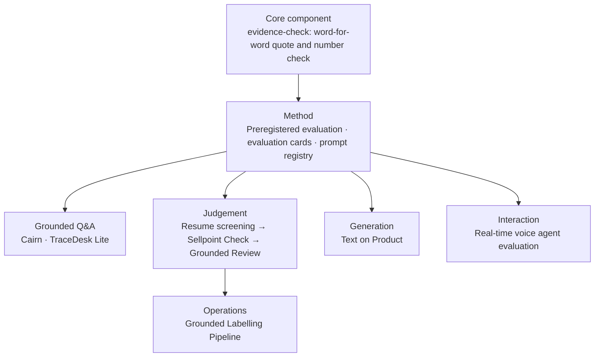

# evidence-first

{{INTRO}}

**Make AI show its evidence.** In two senses:

1. Every sentence an AI writes should point to its source.
2. Every AI capability should bring evaluation evidence before it ships: answers and plan written and frozen first, then the run; every new version re-tested, with the change in score and the reason for adopting it on record.

Each project below applies this thread in one setting: one checking component and one evaluation method, used for grounded Q&A, judgement, generation and interaction.

[中文](README.md)

## Six scenes, from the simplest question to the hardest

Each scene states the problem, what I did and the results, then how it connects to the other projects. Every number is computed by script from the project's result files.

{{SCENES}}

## Structure



The operations layer is the [Grounded Labelling Pipeline](https://github.com/llia0031-dotcom/grounded-labelling-pipeline): it turns Grounded Review into a review workflow with quote checks, a review queue for uncertain ads, prompt versions, canary and rollback, and weekly metrics; its traffic is a replay of test items, not real users.

## All projects

95% intervals, number of runs and source files are on each project's evaluation card.

{{PROJECT_TABLE}}

## Method

| File | What it is |
|---|---|
| [docs/eval-protocol.en.md](docs/eval-protocol.en.md) | Evaluation protocol: preregistration; rule checks on every change, calibrated model grading on every version, canary comparison last; how to report numbers |
| [cards/](cards/) | One evaluation card per project: when, team, stack and "problem / what I did / results" first, then Hugging Face model card sections: uses, out of scope, evaluation data, metrics and results, grader calibration, limitations and failure cases, versions |
| [prompts/](prompts/README.en.md) | Prompt registry: what each version changed, its score at the time, adopted or not and why; production / staging labels; canary replay; release checklist (in Chinese) |
| [data/](data/) | JSON versions of all of the above |

## Scores on every prompt change

`.github/workflows/prompt-regression.yml`: when a pull request changes files under `prompts/`, a GitHub Action runs promptfoo on the versions behind the production and staging labels over one item set (evidence-check development set v1, 12 drafts, model claude-haiku-5-5) and posts both pass counts on the pull request. When GitHub cannot run it, the same configuration runs locally and the result is posted on the pull request, as in [PR 1](https://github.com/llia0031-dotcom/evidence-first/pull/1) (both labels pointed at the same version, so it only shows the flow works).

The Action needs an API key stored in the repository:

1. Open the repository's **Settings → Secrets and variables → Actions**;
2. Click **New repository secret**, name it `ANTHROPIC_API_KEY`, paste your Anthropic API key and save.

During a run the key is written to a temporary file that only the evaluation provider reads, and the file is deleted afterwards; the repository never stores the key.

## Rebuild

Python 3.11+, standard library only. The project folders must sit next to this repository, and their names differ from the GitHub repository names:

| Folder | Public repository |
|---|---|
| `evidence-check-public/` | [evidence-check](https://github.com/llia0031-dotcom/evidence-check) |
| `cairn-public/` | [cairn](https://github.com/llia0031-dotcom/cairn) |
| `grounded-review-public/` | [grounded-review](https://github.com/llia0031-dotcom/grounded-review) |
| `sellpoint-check/` | [sellpoint-check](https://github.com/llia0031-dotcom/sellpoint-check) |
| `screening-audit/` | [evidence-screening](https://github.com/llia0031-dotcom/evidence-screening) |
| `voice-agent-eval/` | [voice-agent-eval](https://github.com/llia0031-dotcom/voice-agent-eval) |
| `evidence-pipeline-public/` | [grounded-labelling-pipeline](https://github.com/llia0031-dotcom/grounded-labelling-pipeline) |
| `grounded-business-review-public/` | [grounded-business-review](https://github.com/llia0031-dotcom/grounded-business-review) |
| `creator-skills-public/` | [creator-skills](https://github.com/llia0031-dotcom/creator-skills) |
| `policy-model-lab-public/` | [policy-model-lab](https://github.com/llia0031-dotcom/policy-model-lab) |
| `judge-calibration-public/` | [judge-calibration](https://github.com/llia0031-dotcom/judge-calibration) |
| `launchpad-tracedesk/` | not public (source of the TraceDesk card) |
| `aigc-scene-eval/` | not public (source of the text-on-product card) |

The result files of the TraceDesk and text-on-product cards are not public, so a rebuild from the public repositories alone reports missing files; the three offline tests that need the project folders are skipped.

```
python scripts/build_cards.py          # cards, project table, data/projects.json, data/story.json
python scripts/build_cards.py --check  # check only: fails if a source result file changed or a generated file is out of date
python scripts/prompts.py build        # prompt registry tables and data/prompts.json
python scripts/replay_canary.py        # canary replay
python -m unittest discover -s tests   # offline tests, no model calls
```
