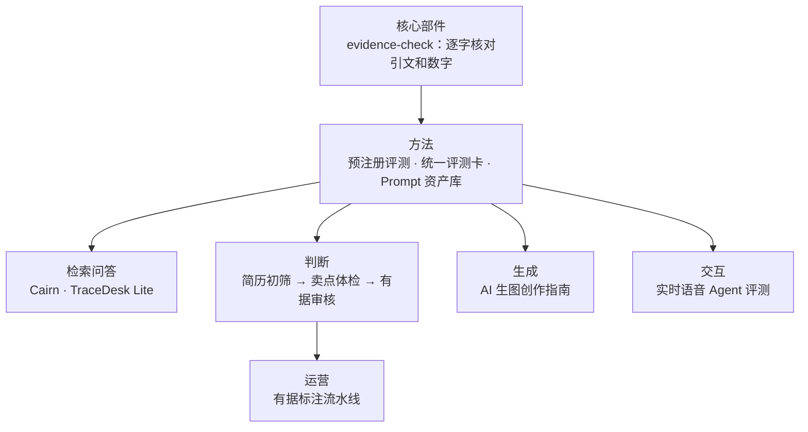

# evidence-first

{{INTRO}}

**让 AI 拿出证据。** 这句话有两层意思：

1. AI 说的每一句话，都要能指到原文。
2. 每个 AI 能力上线前，都要拿出评测证据：先写好答案和计划，冻结，再跑；每改一版就重测，分数变了、为什么采用都写清楚。

下面的项目都是这条主线在不同场景里的一次落地：一个核对部件、一套评测方法，用在检索问答、判断、生成、交互四类场景。

[English](README.en.md)

## 六幕：按问题从简单到复杂

每一幕写三件事：要解决什么问题、我做了什么、结果是多少；最后一行写它和其他项目怎么连起来。数字都由脚本从项目的结果文件算出。

{{SCENES}}

## 结构



运营层是[有据标注流水线](https://github.com/llia0031-dotcom/grounded-labelling-pipeline)：把有据审核接成一条审核工作流，核对引文、拿不准的进复核队列、提示词版本、灰度和回滚、每周指标；流量是评测题回放，不是真实用户。

## 全部项目

比例的 95% 区间、跑了几次、来源文件都在每个项目的评测卡里。

{{PROJECT_TABLE}}

## 方法

| 文件 | 是什么 |
|---|---|
| [docs/eval-protocol.md](docs/eval-protocol.md) | 统一评测协议：预注册；规则检查每次都跑，模型评判先校准再定期跑，灰度对比放最后；怎么报告数字 |
| [cards/](cards/) | 每个项目一张评测卡：开头是时间、团队、技术和“问题 / 我做了什么 / 结果”，后面照 Hugging Face 模型卡写用途、不适用的地方、评测数据、指标和结果、评分器校准、局限和失败案例、版本 |
| [prompts/](prompts/) | Prompt 资产库：每一版改了什么、当时的分数、采用还是不采用、为什么；production / staging 标签；灰度回放演示；上线检查清单 |
| [data/](data/) | 上面这些内容的 JSON 版本 |

## 改提示词时自动对比分数

`.github/workflows/prompt-regression.yml`：有人开 PR 改了 `prompts/` 下的文件，GitHub Action 就用 promptfoo 把 production 和 staging 两个标签指向的版本放在同一套题上跑（evidence-check 的开发评测 v1，12 篇草稿，模型 claude-haiku-5-5），把两版的通过数贴到 PR 里。GitHub 上跑不了这套评测时，就在本机用同一份配置跑，把结果贴进 PR，例如 [PR 1](https://github.com/llia0031-dotcom/evidence-first/pull/1)（那次两个标签指向同一版，只说明流程跑得通）。

要先在仓库里加一个密钥，Action 才能调用模型：

1. 打开仓库的 **Settings → Secrets and variables → Actions**；
2. 点 **New repository secret**，名字填 `ANTHROPIC_API_KEY`，值填自己的 Anthropic API 密钥，保存。

Action 运行时把密钥写进一个临时文件，只由评测脚本读取，跑完就删掉；仓库里不存密钥。

## 重新生成

需要 Python 3.11 以上，只用标准库。各项目的文件夹要和本仓库放在同一层，文件夹名和 GitHub 仓库名不完全一样：

| 文件夹 | 公开仓库 |
|---|---|
| `evidence-check-public/` | [evidence-check](https://github.com/llia0031-dotcom/evidence-check) |
| `cairn-public/` | [cairn](https://github.com/llia0031-dotcom/cairn) |
| `grounded-review-public/` | [grounded-review](https://github.com/llia0031-dotcom/grounded-review) |
| `sellpoint-check/` | [sellpoint-check](https://github.com/llia0031-dotcom/sellpoint-check) |
| `screening-audit/` | [evidence-screening](https://github.com/llia0031-dotcom/evidence-screening) |
| `voice-agent-eval/` | [voice-agent-eval](https://github.com/llia0031-dotcom/voice-agent-eval) |
| `evidence-pipeline-public/` | [grounded-labelling-pipeline](https://github.com/llia0031-dotcom/grounded-labelling-pipeline) |
| `grounded-business-review-public/` | [grounded-business-review](https://github.com/llia0031-dotcom/grounded-business-review) |
| `creator-skills-public/` | [creator-skills](https://github.com/llia0031-dotcom/creator-skills) |
| `policy-model-lab-public/` | [policy-model-lab](https://github.com/llia0031-dotcom/policy-model-lab) |
| `launchpad-tracedesk/` | 没有公开（TraceDesk 卡的来源） |
| `aigc-scene-eval/` | 没有公开（AI 生图卡的来源） |

TraceDesk 和 AI 生图两张卡的结果文件没有公开，所以只用公开仓库重建会报缺文件；离线自检里依赖各项目文件夹的三项会跳过。

```
python scripts/build_cards.py          # 评测卡、总表、data/projects.json、data/story.json
python scripts/build_cards.py --check  # 只检查：来源结果文件变了、生成的文件过时，都会报错
python scripts/prompts.py build        # Prompt 资产库的版本表和 data/prompts.json
python scripts/replay_canary.py        # 灰度回放演示
python -m unittest discover -s tests   # 离线自检，不调用模型
```
